# Entity-relationship diagram

Generated from `crates/means-core/migrations/` by `scripts/gen_erd.py`; regenerate after a migration, never edit.
See [the accounting model](data-model.md) for the meaning of each table. Money columns are INTEGER counts of the minor unit of their commodity. Dates are TEXT `YYYY-MM-DD`.

```mermaid
erDiagram
  entities {
    INTEGER id PK
    TEXT uid UK
    TEXT name UK
    TEXT kind
    TEXT country
    TEXT currency
    TEXT lock_date
    TEXT archived_at
    TEXT created_at
    TEXT updated_at
    TEXT legal_form
    TEXT fiscal_year_end
    TEXT registrations
    TEXT incorporated_on
  }
  entity_classifications {
    INTEGER id PK
    INTEGER entity_id FK "entities"
    TEXT jurisdiction
    TEXT classification
    TEXT effective_from
    TEXT effective_to
    TEXT note
    TEXT created_at
  }
  entity_groups {
    INTEGER id PK
    TEXT uid UK
    TEXT name UK
    TEXT created_at
  }
  entity_group_members {
    INTEGER id PK
    INTEGER group_id FK "entity_groups"
    INTEGER entity_id FK "entities"
    INTEGER parent_entity_id FK "entities"
    INTEGER ownership_bp
    INTEGER control
    TEXT effective_from
    TEXT effective_to
    TEXT created_at
  }
  commodities {
    INTEGER id PK
    TEXT code UK
    TEXT kind
    TEXT name
    INTEGER precision
    TEXT isin
  }
  prices {
    INTEGER id PK
    INTEGER commodity_id FK "commodities"
    INTEGER currency_id FK "commodities"
    TEXT on_date
    TEXT price
    TEXT source
  }
  accounts {
    INTEGER id PK
    TEXT uid UK
    INTEGER entity_id FK "entities"
    INTEGER parent_id FK "accounts"
    TEXT code
    TEXT name
    TEXT type
    TEXT subtype
    INTEGER commodity_id FK "commodities"
    TEXT system_role
    INTEGER placeholder
    INTEGER in_net_worth
    TEXT credit_limit
    INTEGER statement_day
    INTEGER due_day
    TEXT external_ids
    TEXT notes
    INTEGER position
    TEXT closed_at
    TEXT created_at
    TEXT updated_at
    TEXT class
    TEXT statutory_code
    TEXT tax_treatment
    INTEGER intercompany
  }
  journal_entries {
    INTEGER id PK
    TEXT uid UK
    INTEGER entity_id FK "entities"
    TEXT date
    TEXT payee
    TEXT description
    TEXT notes
    TEXT status
    INTEGER reverses_id FK "journal_entries"
    INTEGER counterpart_id FK "journal_entries"
    INTEGER template_id FK "entry_templates"
    INTEGER template_version
    TEXT origin
    TEXT posted_at
    INTEGER seq
    TEXT prev_hash
    TEXT hash
    TEXT created_at
    TEXT updated_at
    TEXT reviewed_at
    INTEGER refund_of_id FK "journal_entries"
    INTEGER payee_id FK "payees"
  }
  postings {
    INTEGER id PK
    TEXT uid UK
    INTEGER journal_entry_id FK "journal_entries"
    INTEGER account_id FK "accounts"
    INTEGER quantity
    INTEGER amount
    TEXT rate
    TEXT rate_source
    TEXT memo
    TEXT metadata
    TEXT external_id
    TEXT fingerprint
    TEXT reconciled_at
    INTEGER position
  }
  entry_tags {
    INTEGER entry_id PK "journal_entries"
    TEXT key PK
    TEXT value PK
  }
  entry_templates {
    INTEGER id PK
    TEXT uid UK
    INTEGER entity_id FK "entities"
    TEXT name
    TEXT payee
    TEXT description
    TEXT lines
    TEXT rrule
    TEXT starts_on
    TEXT next_on
    TEXT ends_on
    INTEGER auto_post
    INTEGER lead_days
    INTEGER version
    INTEGER active
    TEXT created_at
    TEXT updated_at
  }
  rules {
    INTEGER id PK
    INTEGER entity_id FK "entities"
    TEXT name
    INTEGER position
    INTEGER enabled
    TEXT conditions
    INTEGER account_id FK "accounts"
    INTEGER template_id FK "entry_templates"
    TEXT payee
    INTEGER hits_count
    TEXT created_at
    TEXT tags
  }
  payees {
    INTEGER id PK
    TEXT uid UK
    INTEGER entity_id FK "entities"
    TEXT name
    INTEGER active
    TEXT country
    TEXT tax_ids
    TEXT kind
  }
  payee_aliases {
    INTEGER payee_id PK "payees"
    TEXT text
    TEXT normalized PK
  }
  party_relationships {
    INTEGER id PK
    INTEGER payee_id FK "payees"
    INTEGER entity_id FK "entities"
    TEXT kind
    INTEGER ownership_bp
    TEXT effective_from
    TEXT effective_to
    TEXT basis
    TEXT created_at
  }
  budgets {
    INTEGER id PK
    TEXT uid UK
    INTEGER entity_id FK "entities"
    TEXT name
    TEXT scope
    INTEGER account_id FK "accounts"
    TEXT class
    TEXT tag
    TEXT starts_on
    TEXT ends_on
    INTEGER amount
    TEXT created_at
    TEXT updated_at
  }
  imports {
    INTEGER id PK
    TEXT uid UK
    TEXT source
    INTEGER account_id FK "accounts"
    TEXT filename
    TEXT checksum
    TEXT status
    TEXT period_from
    TEXT period_to
    TEXT opening_balance
    TEXT closing_balance
    INTEGER lines_count
    INTEGER created_count
    INTEGER matched_count
    INTEGER duplicate_count
    INTEGER skipped_count
    INTEGER unmatched_count
    INTEGER error_count
    TEXT error
    TEXT options
    BLOB content
    TEXT created_at
  }
  statement_lines {
    INTEGER id PK
    INTEGER import_id FK "imports"
    INTEGER account_id FK "accounts"
    INTEGER position
    TEXT raw
    TEXT date
    INTEGER amount
    TEXT currency
    TEXT description
    TEXT reference
    INTEGER balance_after
    TEXT fingerprint
    INTEGER posting_id FK "postings"
    INTEGER journal_entry_id FK "journal_entries"
    INTEGER duplicate_of_id FK "statement_lines"
    TEXT status
    TEXT note
  }
  import_profiles {
    INTEGER id PK
    TEXT source
    TEXT filename_glob
    INTEGER account_id FK "accounts"
    INTEGER hits_count
    TEXT updated_at
  }
  documents {
    INTEGER id PK
    TEXT uid UK
    INTEGER entity_id FK "entities"
    TEXT sha256
    TEXT filename
    TEXT mime
    INTEGER size
    TEXT stored_path
    TEXT source
    TEXT received_at
    TEXT metadata
    TEXT created_at
  }
  document_links {
    INTEGER id PK
    INTEGER document_id FK "documents"
    INTEGER entry_id FK "journal_entries"
    INTEGER posting_id FK "postings"
    INTEGER statement_line_id FK "statement_lines"
    TEXT role
    TEXT created_at
  }
  tax_codes {
    INTEGER id PK
    TEXT uid UK
    INTEGER entity_id FK "entities"
    TEXT code
    TEXT name
    TEXT kind
    INTEGER rate_bp
    INTEGER tax_account_id FK "accounts"
    INTEGER recoverable_bp
    TEXT jurisdiction
    TEXT effective_from
    TEXT effective_to
    INTEGER active
    TEXT created_at
  }
  tax_events {
    INTEGER id PK
    TEXT uid UK
    INTEGER entity_id FK "entities"
    INTEGER entry_id FK "journal_entries"
    INTEGER posting_id FK "postings"
    INTEGER tax_code_id FK "tax_codes"
    TEXT tax_point
    INTEGER base_amount
    INTEGER tax_amount
    INTEGER recoverable_amount
    INTEGER withheld_amount
    TEXT commodity
    INTEGER native_base
    INTEGER native_tax
    TEXT native_commodity
    INTEGER party_id FK "payees"
    TEXT document_ref
    TEXT rule_version
    INTEGER corrects_event_id FK "tax_events"
    TEXT metadata
    TEXT created_at
  }
  invoices {
    INTEGER id PK
    TEXT uid UK
    INTEGER entity_id FK "entities"
    TEXT direction
    INTEGER party_id FK "payees"
    TEXT number
    TEXT series
    TEXT issue_date
    TEXT tax_point
    TEXT due_date
    TEXT commodity
    INTEGER net
    INTEGER tax
    INTEGER gross
    INTEGER withheld
    TEXT status
    TEXT kind
    INTEGER credits_invoice_id FK "invoices"
    INTEGER recognition_entry_id FK "journal_entries"
    INTEGER document_id FK "documents"
    TEXT external_ref
    TEXT metadata
    TEXT created_at
    TEXT updated_at
  }
  invoice_lines {
    INTEGER id PK
    INTEGER invoice_id FK "invoices"
    INTEGER position
    TEXT description
    TEXT quantity
    INTEGER unit_price
    INTEGER net
    TEXT tax_code
    INTEGER tax
    INTEGER account_id FK "accounts"
  }
  settlements {
    INTEGER id PK
    TEXT uid UK
    INTEGER invoice_id FK "invoices"
    INTEGER entry_id FK "journal_entries"
    INTEGER posting_id FK "postings"
    TEXT date
    INTEGER amount
    TEXT kind
    INTEGER fx_difference_entry_id FK "journal_entries"
    INTEGER credit_note_id FK "invoices"
    TEXT created_at
  }
  intervault_links {
    INTEGER id PK
    TEXT uid UK
    INTEGER entry_a_id FK "journal_entries"
    INTEGER entry_b_id FK "journal_entries"
    TEXT kind
    INTEGER amount_a
    TEXT commodity_a
    INTEGER amount_b
    TEXT commodity_b
    TEXT rate
    TEXT note
    TEXT status
    TEXT created_at
    TEXT updated_at
  }
  filings {
    INTEGER id PK
    TEXT uid UK
    INTEGER entity_id FK "entities"
    TEXT jurisdiction
    TEXT filing_code
    TEXT period_start
    TEXT period_end
    TEXT status
    TEXT snapshot_digest
    INTEGER chain_head_seq
    TEXT chain_head_hash
    TEXT artifact_digest
    TEXT receipt_ref
    TEXT submitted_at
    TEXT notes
    INTEGER amends_id FK "filings"
    TEXT created_at
    TEXT updated_at
  }
  audit_log {
    INTEGER id PK
    TEXT at
    TEXT table_name
    INTEGER row_id
    TEXT action
    TEXT before
    TEXT after
    TEXT actor
    TEXT reason
  }
  settings {
    TEXT key PK
    TEXT value
  }
  channel_connections {
    INTEGER id PK
    TEXT channel
    TEXT item_id
    TEXT provider_account_id
    TEXT provider_type
    TEXT name
    TEXT currency
    INTEGER account_id FK "accounts"
    TEXT cursor
    TEXT last_pull_at
    TEXT created_at
    TEXT booked_from
  }
  connection_jobs {
    TEXT id PK
    TEXT provider
    TEXT operation
    TEXT target
    TEXT state
    TEXT message
    TEXT started_at
    TEXT finished_at
  }
  enable_banking_sessions {
    TEXT id PK
    TEXT bank
    TEXT country
    TEXT valid_until
    TEXT created_at
  }
  enable_banking_account_aliases {
    TEXT hash PK
    TEXT currency PK
    INTEGER connection_id FK "channel_connections"
  }
  accounts |o--o{ accounts : "parent_id"
  accounts |o--o{ budgets : "account_id"
  accounts |o--o{ channel_connections : "account_id"
  accounts |o--o{ imports : "account_id"
  accounts |o--o{ invoice_lines : "account_id"
  accounts |o--o{ rules : "account_id"
  accounts |o--o{ statement_lines : "account_id"
  accounts |o--o{ tax_codes : "tax_account_id"
  accounts ||--o{ import_profiles : "account_id"
  accounts ||--o{ postings : "account_id"
  channel_connections ||--o{ enable_banking_account_aliases : "connection_id"
  commodities ||--o{ accounts : "commodity_id"
  commodities ||--o{ prices : "commodity_id"
  commodities ||--o{ prices : "currency_id"
  documents |o--o{ invoices : "document_id"
  documents ||--o{ document_links : "document_id"
  entities |o--o{ entity_group_members : "parent_entity_id"
  entities ||--o{ accounts : "entity_id"
  entities ||--o{ budgets : "entity_id"
  entities ||--o{ documents : "entity_id"
  entities ||--o{ entity_classifications : "entity_id"
  entities ||--o{ entity_group_members : "entity_id"
  entities ||--o{ entry_templates : "entity_id"
  entities ||--o{ filings : "entity_id"
  entities ||--o{ invoices : "entity_id"
  entities ||--o{ journal_entries : "entity_id"
  entities ||--o{ party_relationships : "entity_id"
  entities ||--o{ payees : "entity_id"
  entities ||--o{ rules : "entity_id"
  entities ||--o{ tax_codes : "entity_id"
  entities ||--o{ tax_events : "entity_id"
  entity_groups ||--o{ entity_group_members : "group_id"
  entry_templates |o--o{ journal_entries : "template_id"
  entry_templates |o--o{ rules : "template_id"
  filings |o--o{ filings : "amends_id"
  imports ||--o{ statement_lines : "import_id"
  invoices |o--o{ invoices : "credits_invoice_id"
  invoices |o--o{ settlements : "credit_note_id"
  invoices ||--o{ invoice_lines : "invoice_id"
  invoices ||--o{ settlements : "invoice_id"
  journal_entries |o--o{ document_links : "entry_id"
  journal_entries |o--o{ invoices : "recognition_entry_id"
  journal_entries |o--o{ journal_entries : "counterpart_id"
  journal_entries |o--o{ journal_entries : "refund_of_id"
  journal_entries |o--o{ journal_entries : "reverses_id"
  journal_entries |o--o{ settlements : "entry_id"
  journal_entries |o--o{ settlements : "fx_difference_entry_id"
  journal_entries |o--o{ statement_lines : "journal_entry_id"
  journal_entries ||--o{ entry_tags : "entry_id"
  journal_entries ||--o{ intervault_links : "entry_a_id"
  journal_entries ||--o{ intervault_links : "entry_b_id"
  journal_entries ||--o{ postings : "journal_entry_id"
  journal_entries ||--o{ tax_events : "entry_id"
  payees |o--o{ invoices : "party_id"
  payees |o--o{ journal_entries : "payee_id"
  payees |o--o{ tax_events : "party_id"
  payees ||--o{ party_relationships : "payee_id"
  payees ||--o{ payee_aliases : "payee_id"
  postings |o--o{ document_links : "posting_id"
  postings |o--o{ settlements : "posting_id"
  postings |o--o{ statement_lines : "posting_id"
  postings |o--o{ tax_events : "posting_id"
  statement_lines |o--o{ document_links : "statement_line_id"
  statement_lines |o--o{ statement_lines : "duplicate_of_id"
  tax_codes ||--o{ tax_events : "tax_code_id"
  tax_events |o--o{ tax_events : "corrects_event_id"
```

